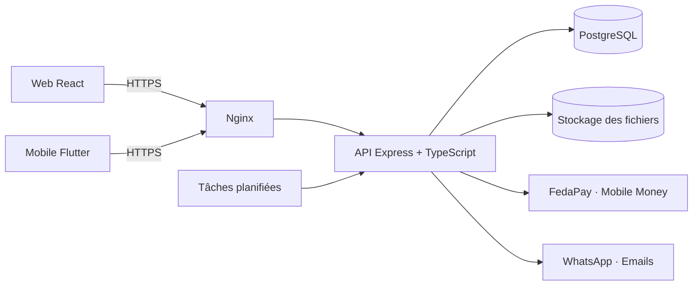

# HopeGestion

**Plateforme de gestion locative pensée pour le Bénin** : biens, locataires, baux, échéanciers, paiements Mobile Money, quittances et états des lieux, dans un seul outil.

- Application web : [hopegestion.com](https://hopegestion.com)
- Application mobile (Flutter) : [WarisseCode/HopeGestionMobile](https://github.com/WarisseCode/HopeGestionMobile)
- **Statut** : en ligne, en phase de tests et d’ajustements avant l’ouverture aux premiers clients.

---

## Le problème

Au Bénin, beaucoup de gestionnaires et de propriétaires suivent encore loyers, baux et locataires dans des cahiers, des fichiers Excel ou des conversations WhatsApp. Les retards de paiement sont repérés trop tard, les quittances se perdent et personne n’a de vue d’ensemble.

HopeGestion couvre tout le cycle locatif — **bien → locataire → bail → échéancier → paiement → quittance → état des lieux** — avec ce que les utilisateurs utilisent déjà : le **FCFA**, le **Mobile Money** et **WhatsApp**.

## Fonctionnalités

| Domaine | Ce que la plateforme permet |
|---|---|
| Parc immobilier | Immeubles et lots, occupation, propriétaires |
| Locataires | Fiches, situation de paiement, contact direct (appel, WhatsApp) |
| Baux & contrats | Création, signature électronique, renouvellement, résiliation, génération du contrat en PDF |
| Argent | Échéanciers, encaissements, paiement en ligne par Mobile Money (FedaPay), quittances PDF, rapports |
| Suivi des logements | États des lieux avec signature sur place, inventaires, interventions |
| Réservations | Demandes reçues depuis le site public, transformation en bail |
| Alertes | Rappels automatiques (échéances, interventions, tâches) |

**Quatre profils** ont chacun leur espace : gestionnaire, propriétaire, locataire, administrateur. Chaque propriétaire ne voit que ses propres données. Interface en **français et en anglais**, thème clair et sombre, adaptée au mobile.

## Stack technique

| Couche | Technologies |
|---|---|
| Backend | Node.js 20, Express 5, TypeScript, PostgreSQL (`pg`, requêtes SQL paramétrées, sans ORM) |
| Authentification | JWT + refresh tokens, cookies httpOnly (web), routes dédiées au mobile, Google OAuth |
| Frontend | React 19, Vite, TailwindCSS 4 + DaisyUI, TanStack Query, React Router 7, i18next, Recharts |
| Mobile | Flutter (dépôt séparé), sur la même API |
| Intégrations | FedaPay (Mobile Money), Twilio (WhatsApp), Nodemailer (emails), PDFKit et ExcelJS (documents) |
| Fichiers | DigitalOcean Spaces (compatible S3), disque local en développement |
| Sécurité | Helmet, limitation de débit, validation des entrées, isolation des données par propriétaire |
| Production | VPS, PM2, Nginx, déploiement automatique par GitHub Actions |

## Architecture



## Structure du dépôt

```
backend/        API Express (routes, services, middleware, tests, scripts)
frontend/       Application web React
shared/types/   Types TypeScript partagés entre le backend et le frontend
nginx/          Configuration Nginx de production
scripts/        Scripts d’installation du serveur et utilitaires
docs/           Documentation (déploiement, architecture, journal du projet, design)
```

## Lancer le projet en local

Prérequis : **Node.js 20** (voir `.nvmrc`) et **PostgreSQL**.

**1. Backend**

```bash
cd backend
cp .env.example .env        # puis renseigner la base (DATABASE_URL ou DB_HOST, DB_USER, DB_PASSWORD, DB_NAME) et JWT_SECRET
npm install
psql "$DATABASE_URL" -f db/init.sql   # une seule fois, sur une base vide
npm run dev                 # les migrations s’appliquent au démarrage
```

**2. Frontend**

```bash
cd frontend
cp .env.example .env        # VITE_API_URL=http://localhost:5000
npm install
npm run dev
```

Les intégrations externes (FedaPay, Twilio, Spaces, emails) sont facultatives en local : sans leurs clés, l’application fonctionne avec un stockage local et l’envoi WhatsApp passe en mode simulation.

## Tests et qualité

```bash
cd backend && npm test        # Jest + Supertest
cd backend && npm run lint
cd frontend && npm run lint
cd frontend && npm run build  # vérification des types puis build
```

## Déploiement

Chaque fusion sur `main` déclenche le déploiement sur le VPS (`.github/workflows/deploy.yml`) : build du backend, migrations, redémarrage PM2, build du frontend, rechargement de Nginx. Guide complet : [docs/DEPLOIEMENT_VPS.md](docs/DEPLOIEMENT_VPS.md).

## Documentation

- [Journal du projet](docs/JOURNAL_PROJET.md) : chaque évolution, ses choix techniques et ses difficultés
- [Règles d’architecture](docs/ARCHITECTURE_RULES.md)
- [API pour l’application mobile](docs/API_DOCUMENTATION_MOBILE.md)
- [Charte graphique](docs/design/CHARTE_GRAPHIQUE.md)
- [Suivi des améliorations](docs/suivi/)
- Anciennes configurations d’hébergement (Render, Railway, DigitalOcean), conservées pour mémoire : [docs/archive/anciens-hebergeurs/](docs/archive/anciens-hebergeurs/)

## Auteur

**Warisse Olouwadamilaré OTCHADE** — conception et développement, depuis décembre 2025, avec l’assistance de Claude Code.
